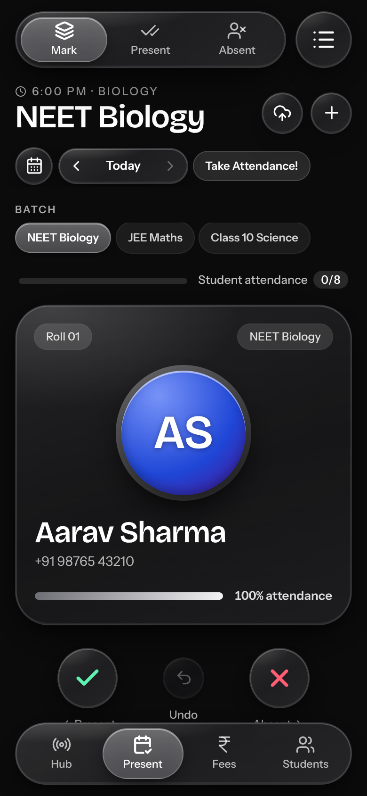
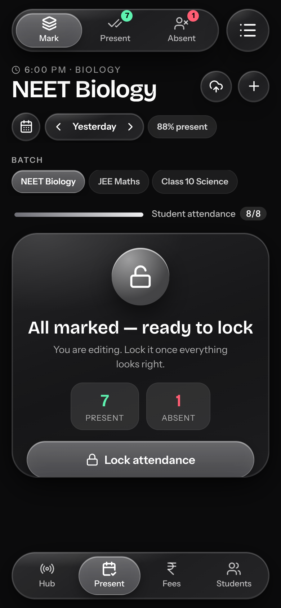
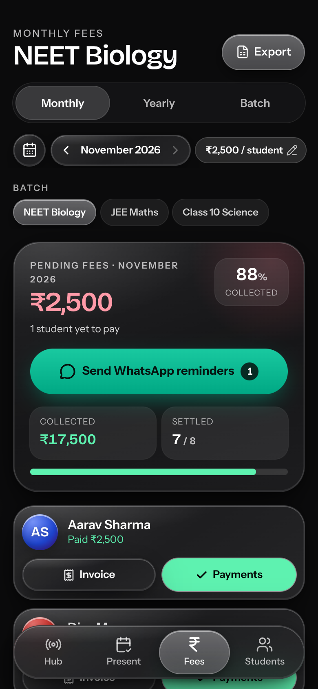
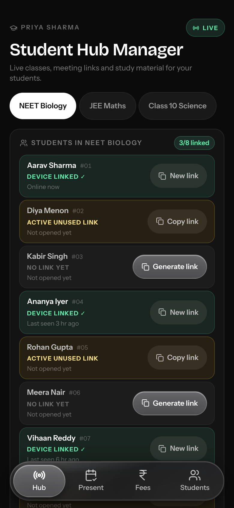

# Coaching Sathi

An offline-first, installable PWA for small coaching centres in India: swipe to mark attendance,
track monthly fees, take payments, send WhatsApp messages to parents, and export reports to Excel.

[](https://vercel.com/new/clone?repository-url=https%3A%2F%2Fgithub.com%2FVinaySoni-IN%2FCoaching-Sathi&framework=vite)

Workspace data is stored on the device (`localStorage`) and is the source of truth. Supabase Auth owns
teacher accounts; workspace data leaves the phone only when the teacher explicitly uploads a cloud backup
or downloads a JSON backup file. The Student Hub's live meeting state and teacher-uploaded notes are
separate, purpose-built Supabase tables with row-level security.

## Screenshots

Every shot below is the real app, captured at phone width (390 × 844 @2x) while signed in as the demo
teacher *Priya Sharma · Bright Minds Academy* — 21 students across **NEET Biology**, **JEE Maths** and
**Class 10 Science**.

| Swipe attendance | All marked — ready to lock |
| --- | --- |
|  |  |
| **Fees ledger** | **Students** |
|  |  |
| **Student Hub Manager (teacher)** | **Student Portal (student)** |
|  |  |

### About the demo data

The shots were taken with the app's own **sample workspace** — the *Start with sample students* checkbox
on the sign-up screen (21 students across three batches, nine days of attendance, a month of fee
receipts). It is generated on the device and never leaves it unless you upload a backup, so no demo
roster exists in Supabase and no demo login is published here.

## Features

- **Swipe attendance** — swipe a student card left for **present**, right for **absent**
  (`src/components/SwipeDeck.tsx`). A calendar sheet lets you open any past day; days can be locked
  once they're done so marks don't change by accident.
- **Students & batches** — add/edit students and batches, roll numbers, join dates, optional profile
  details (DOB, parent name and phone, profile photo resized in the browser before saving).
- **Fees ledger** — monthly fee per batch with fee history, per-student discounts and extra charges,
  partial and back-dated payments, receipts with sequential numbers, FIFO or month-first allocation,
  reversals that never delete history, and derived outstanding/advance balances
  (`src/lib/ledger.ts`, `src/lib/accounts.ts`, `src/lib/payments.ts`).
- **Reminders & messages** — templated WhatsApp messages for presence, absence and fee reminders,
  opened through `wa.me` links (`src/lib/wa.ts`).
- **Reports** — printable invoices/statements and `.xlsx` export via SheetJS (`src/lib/report.ts`).
- **Manual cloud Backup & Restore** — the cloud button beside `+` opens exactly two actions:
  *Upload Backup (Sync to Cloud)* and *Download &amp; Overwrite (Restore Data)*. Each backup is one
  complete, replaceable snapshot tied to the signed-in teacher with row-level security
  (`src/lib/cloudBackup.ts`, `src/components/BackupMenu.tsx`, `supabase/migrations/`).
- **File backup & restore** — JSON export/import of a teacher's whole dataset (`src/lib/backup.ts`).
- **Teacher accounts** — Supabase Auth handles email + password, session restore, password reset and
  the profile name. One device keeps each teacher's workspace under its own `coachdesk:data:<userId>`
  key; no background sync or merge runs (`src/lib/auth.ts`). Deleting the account requires typing
  `DELETE` and erases the profile, workspace, legacy rows and cloud backup from the device and Supabase.
- **Student Hub Manager** — the first (far-left) Teacher App icon controls the live class topic/URL,
  **meeting duration (30/45/60 quick buttons + custom minutes → `duration_minutes` / `expires_at`)**,
  switches the class ON/OFF, and organises files/PDFs, links and text notes into **batch-tagged folders**.
  It also copies the `./student-hub/` link (`src/components/StudentHubManager.tsx`, `src/lib/studentHub.ts`).
- **Student Portal** — `student-hub/index.html` is a standalone, read-only, single-page portal: one-time
  name + batch onboarding saved in `localStorage`, a teacher picker and top-bar **Switch Teacher** control,
  a live card with a duration badge and countdown that hides the class at `expires_at`, and notes grouped by
  folder for exactly the selected batch and teacher. Relative assets, anonymous SELECT-only client.
- **Installable PWA** — manifest, maskable icons and service worker (`public/`).

## Getting started

```bash
npm install
npm run dev        # http://localhost:5173
```

| Script | What it does |
| --- | --- |
| `npm run dev` | Vite dev server (binds to all interfaces, accepts proxied preview hosts) |
| `npm run build` | Type-check (`tsc -b`) and build to `dist/` |
| `npm run preview` | Serve the production build |
| `npm test` | Vitest suite (happy-dom), 391 tests across 26 files |
| `npm run lint` | ESLint (0 errors; React Compiler advisories surface as warnings) |

## Project layout

```
src/
  App.tsx            shell, routing between pages, all the confirm/toast orchestration
  components/        screens, bottom sheets, BackupMenu and StudentHubManager
  lib/
    store.ts         persisted state + useAttendance hook
    studentHub.ts   meeting duration, batch folders and notes helpers for the Teacher App
    sanitize.ts     trim/control-strip/escaping for all Teacher App text inputs
    ledger.ts        fee steps, marks, derivation/sanitising of saved state
    accounts.ts      statements, outstanding, ageing
    payments.ts      receipts, allocation, discounts, charges, reversals
    report.ts        invoice/report rendering + xlsx export
    wa.ts            WhatsApp templates and link building
    auth.ts          Supabase teacher accounts and sessions
    cloud.ts         lazy Supabase client + friendly error messages
    cloudBackup.ts   explicit snapshot upload / fetch / local overwrite
    money.ts, phone.ts, email.ts, backup.ts, photo.ts, …
public/              manifest, app icons + favicon, service worker
student-hub/         standalone Student Portal: index.html, styles.css, portal.js, sanitize.js,
                     config.json, vendor/supabase.js
tests/               Vitest suites (unit + component + E2E-style flows)
```

## Notes

- Money is handled in **paise** (integers) everywhere; `src/lib/money.ts` formats to ₹.
- Storage keys are prefixed `coachdesk:` — accounts, session, and one data blob per teacher.
- `xlsx` is installed from the npm registry (`^0.18.5`) rather than the SheetJS CDN tarball so
  `npm ci` works in environments that can't reach `cdn.sheetjs.com`.
- All asset URLs are relative (`base: './'`) and the service worker caches with relative paths, so the
  build works from a domain root *or* a sub-path without changes. The Student Portal uses only relative
  paths too, and the service worker deliberately leaves `/student-hub/` to the network.
- `student-hub/config.json` contains the same **public** Supabase URL and anon key used by the Teacher
  App. `VITE_SUPABASE_URL` / `VITE_SUPABASE_ANON_KEY` override it when pointing both apps at another
  project. RLS, not the anon key, protects writes.
- CI (`.github/workflows/ci.yml`) runs lint + tests + build on every push to `main` and every PR.

## Branding & app icons

The neon Coaching Sathi artwork — cap, books, magnifier and wordmark inside a glowing violet
frame — is used **only where the OS draws the icon**. Inside the app the sign-in card keeps its
original `GraduationCap` glyph, and no brand image is rendered in the UI.

**Rounded, transparent corners.** The artwork is already a rounded neon tile on transparency, so the
build keeps that alpha channel instead of flattening it onto a black square: `icon-192` / `icon-512`
and the favicons have real transparency outside the tile's own curve. Only the two surfaces that
cannot take transparency stay opaque:

| File | Corners | Why |
| --- | --- | --- |
| `icon-192-v10.png` / `icon-512-v10.png` | **rounded, transparent** | manifest `purpose: any` |
| `icon-maskable-512-v10.png` | opaque, art inset to 82 % | Android crops it to its own shape; transparency would be padded to black anyway |
| `apple-touch-icon-v10.png` | opaque, square | iOS composites alpha onto **black** and applies its own mask — a pre-rounded tile would show black wedges at the corners |

### Browser tab icon is a different mark — a transparent sticker

The **home-screen / installed-app icon** is the neon "CS + graduation cap" tile and is declared
only in `manifest.webmanifest` (+ the `apple-touch-icon` link). It is never touched by favicon work.

The **browser tab icon** is the glossy *purple CS graduation emblem* (`Glossy Purple CS Graduation Emblem.png`), cut out of its pure-black background
so it floats as a transparent sticker — no tile, no rounded app-icon frame:

| File | Sizes | Notes |
| --- | --- | --- |
| `favicon-anim-32-v13.png` | 32² | APNG, 16 frames, 2.2 s neon pulse, ~41 KB |
| `favicon-anim-64-v13.png` | 64² | same cycle for hi-DPI tabs |
| `favicon-128-v13.png` | 128² | static, bookmarks / pinned tabs |
| `favicon-v13.ico` | 16²/32²/48² | static fallback, Windows shortcuts |

Chrome, Edge and Firefox animate the APNG in the tab; Safari paints frame 0, which is authored at
peak brightness so a non-animating browser still gets the vivid mark. The cut-out is a border flood
fill of near-black pixels (so the artwork's own dark gradients stay opaque) with a 0.7 px alpha
feather, then 2 % breathing room and a 4× Lanczos downscale with a light unsharp pass. Builder:
`/tmp/fav/make.py`.

- **Icon file names are versioned** (`icon-192-v10.png`, …). Browsers and the `vercel.json` cache
  rules keep icon bytes for up to a year, so re-uploading different pixels to the *same* URL is
  invisible to anyone who has visited before — even after uninstalling the PWA. Bumping the suffix
  gives every release brand-new URLs, which is why those files can be cached `immutable`.
  Changing icons = new suffix + `VERSION` bump in `public/sw.js` (currently `coachsathi-v19`).

## Manual Backup &amp; Restore (Supabase)

Accounts are online; **workspace data is local-first**. Supabase Auth supplies the verified teacher ID,
but nothing is pushed, pulled, merged or queued in the background. The cloud is only a replaceable
snapshot for moving data between devices.

| Piece | What it does |
| --- | --- |
| Supabase Auth | email + password, session persisted and refreshed; password reset by email |
| `public.profiles` | one row per user (`id → auth.users`), display name + canonical mailbox |
| `public.cloud_backups` | **one row per teacher**: `user_id → auth.users`, whole snapshot as `jsonb`, `updated_at` |
| `save_my_backup(doc, client)` | the only write path: `user_id` comes from `auth.uid()`, upsert completely overwrites the old copy |
| `read_my_backup()` | the only read path: no user-id argument, so a teacher cannot request another teacher's row |
| `public.app_state`, `sync_log`, SQL views | kept readable for history/reporting; `push_state` and authenticated writes to `app_state` are revoked |
| `delete_me()` | requires the verified `auth.uid()`, then explicitly deletes the cloud backup, sync log, old state, profile and auth user; all FKs also cascade |
| `email_taken()` | one mailbox = one account, even across Gmail dots / `+tags` |

`cloud_backups` has row-level security enabled. Its single `ALL` policy is
`auth.uid() = user_id` for both `USING` and `WITH CHECK`; `anon` has no grants. The migration also
revokes the old `push_state` execute grant and every client-side write privilege on `app_state`
(including `TRUNCATE`, which RLS does not govern), leaving only `SELECT` for historical/reporting use.
A stale cached PWA therefore cannot resume automatic two-way sync.

**Flows**

- **Cloud button** — beside the `+` button on the attendance home header and the Students tab header.
  The popup contains exactly two options: *Upload Backup (Sync to Cloud)* and
  *Download &amp; Overwrite (Restore Data)*.
- **Upload Backup** — builds a sanitized snapshot of the whole local `State` (batches, students,
  attendance, fees, adjustments, charges, message templates, centre, default fee) plus small
  per-teacher UI settings such as the selected batch. `save_my_backup` replaces the previous cloud row
  for `auth.uid()` — no row-by-row merge. A success toast and inline status confirm it.
- **Download &amp; Overwrite** — `read_my_backup` fetches only the authenticated teacher's row. The UI
  shows a confirmation warning, then validates the envelope (including `teacherId`), clears this
  teacher's scoped local keys, writes the snapshot, keeps a `:before-restore` safety copy and adopts
  the new state immediately. No page reload or background merge is needed.
- **Errors** — offline, expired session, unconfigured project, oversized snapshot, damaged backup and
  a new teacher with no backup each produce a clear toast/status without touching local data.

**Local is the source of truth.** `coachdesk:data:<userId>` opens the app instantly and works offline;
`coachdesk:teacher` is the cached identity and is always verified against Supabase. Signing out keeps
the local workspace on the device. Use Upload Backup before switching devices, then Download &amp;
Overwrite there.

**Setup**: run the migrations in `supabase/migrations/` (SQL editor or `supabase db push`), including
`20261119150845_manual_cloud_backups.sql`,
`20261119152547_revoke_app_state_client_writes.sql`,
`20261119165932_delete_account_wipe_all_data.sql`,
`20261120123502_student_hub_live_meeting_notes.sql`,
`20261120125627_student_hub_explicit_anon_deny.sql`,
`20261121173331_student_hub_batches_duration_folders.sql`,
`20261121173440_student_hub_batches_finish_rpcs.sql`, the three strict-scope hardening migrations
`20261121175754_student_hub_scope_headers.sql`,
`20261121175822_student_hub_private_storage.sql`,
`20261121175838_student_hub_snapshot_scope_guard.sql`, and the v3 pair
`20261122182327_student_hub_multi_meetings.sql` +
`20261122182349_student_hub_meeting_rpcs_share.sql`. The public defaults in
`student-hub/config.json` are shared by both apps, so no environment variables are required for the
live project. Set `VITE_SUPABASE_URL` and `VITE_SUPABASE_ANON_KEY` only to override them (see
`.env.example`; both are public values). Vercel already has them for production, preview and
development. The GitHub Pages redirect allow list includes `https://vinaysoni-in.github.io/**`; add
any custom Pages domain to Supabase Auth → URL Configuration as well.

## Student Hub (v3 — many meetings, scheduling, shareable notes)

See [`docs/STUDENT_HUB_BATCH_UPDATE.md`](docs/STUDENT_HUB_BATCH_UPDATE.md) for copy-pasteable SQL and
the Teacher/Student JS changes, separated into three sections.

- **Teacher App** — the far-left **Hub** icon opens Student Hub Manager; Present, Fees, Students and the
  default attendance landing screen are unchanged. A **Batch Name** selector tags every meeting, folder
  and note.
- **Many meetings per teacher** — `live_meetings` now has a uuid `id` primary key (the old
  `teacher_id` primary key is dropped), so one teacher can keep several live or future-scheduled
  classes across batches. `save_my_meeting(p_id, …)` creates or reschedules one, `delete_my_meeting`
  removes it, and `set_my_batch_meeting` remains as a "start this batch now" compatibility wrapper.
  Columns: `meeting_title`, `scheduled_start`, `duration_minutes`, `expires_at`, `status`
  (`scheduled` | `live` | `ended`). A trigger keeps `expires_at = scheduled_start + duration` and
  `is_live` in step; `student_hub_meeting_state()` derives the effective state from the clock so a
  scheduled row turns live at its start time without another write.
- **Scheduling UI** — a native `<input type="datetime-local">` clock picker plus a **Start Now**
  shortcut and a **Go live now** button. **Duration** pairs a number input with a
  **Minutes | Hours** toggle (1.5 h → 90 min before it is sent) and `30 / 45 / 60` presets; the label
  reads `45 Mins` or `1 Hr 30 Mins`. **Scheduled & live meetings** lists every row with `LIVE NOW`,
  `SCHEDULED` or `EXPIRED` badges, batch, start clock time, duration and delete/edit actions.
- **Batch folders & notes** — `public.folders` requires a non-null `batch_name`; `public.student_notes`
  (the notes table) has `batch_name NOT NULL` and `folder_id`. `public.notes` is a `security_invoker`
  view joining each note to its folder. `save_my_folder`, `save_my_batch_note`, `delete_my_folder`
  and `set_my_batch_meeting` are authenticated-only RPCs pinning `teacher_id = auth.uid()`.
- **Student onboarding** — first visit asks for **Full Name** + **Batch** (dropdown built from
  `public.student_hub_directory`), then shows only teachers attached to that batch. `student_name`,
  `selected_batch` and `selected_teacher_id` live in `localStorage`; later visits skip straight to the
  dashboard. The top-bar **Switch Teacher** pill changes teachers in one click; **Change** re-runs setup.
- **Live + upcoming list** — the portal renders every live and scheduled class for the saved batch and
  teacher. Live rows show a pulsing badge, `Duration: 1 Hr 30 Mins`, `Ends in mm:ss` and an active
  **Join Now**; scheduled rows show `SCHEDULED`, the local start clock time, `Starts in …` and an
  inactive *Opens at start time* button until `scheduled_start` arrives. Rows vanish after
  `expires_at`, and the empty state is a friendly "No scheduled classes right now".
- **Shareable notes** — every note has a stable uuid, and `?note=<note_id>` deep-links straight to it
  (the portal clears stale filters, scrolls to and highlights the card, and shows a friendly notice if
  the note is not in scope). Both apps expose a copy-link action:
  `<student-hub>/?note=<uuid>`.
- **Storage-safe deletes** — deleting a note calls
  `storage.from('student_notes').remove([storage_path])` first and only then deletes the metadata row.
  The SQL never deletes `storage.objects` (Supabase rejects that with *"Direct deletion from storage
  tables is not allowed. Use the Storage API instead."*); account deletion purges the teacher's folder
  through the Storage API before calling `delete_me()`.
- **Strictly scoped reads** — `student_hub_snapshot(p_batch_name, p_teacher_id)` is a read-only
  SECURITY DEFINER RPC whose `WHERE` clause pins **both** columns and whose guard rejects a request when
  `X-Student-Hub-Batch` / `X-Student-Hub-Teacher-Id` do not match the arguments. Every direct table,
  view and Storage read carries the same headers; RLS policies call `student_hub_scope_matches()` and
  return zero rows without a matching pair. Notes are grouped by folder and labelled with the batch.
- **Private Storage** — `student_notes` is a private bucket. The Teacher App opens its own files with
  one-hour signed URLs; the Student Portal fetches a file as a Blob from the scoped Storage endpoint
  and opens/downloads a temporary `blob:` URL. No public object URL can bypass RLS.
- **RLS** — anon gets scoped `SELECT` only and has explicit deny policies for INSERT/UPDATE/DELETE on
  all Hub tables and Storage objects. Authenticated teachers have SELECT/INSERT/UPDATE/DELETE policies
  scoped to `auth.uid() = teacher_id`; `delete_me()` erases notes, folders, meetings, backups, sync
  log, app state and the auth user (Storage files are removed by the client first). The anon policy on
  `live_meetings` also hides ended rows, so only live and upcoming classes are ever readable.
  All text is trimmed/control-stripped, escaped for HTML-string contexts, and all URLs are http(s)-checked
  (`src/lib/sanitize.ts`, `student-hub/sanitize.js`).
- **Isolation caveat** — the portal is intentionally public/anon, and the database enforces that every
  read supplies a matching `(batch_name, teacher_id)` pair. Because there is no student identity, a
  technically sophisticated caller holding the public anon key can still choose a different pair in
  the headers; that is as strong as anonymous, link-shared access can be. Cryptographic per-student
  isolation would require student auth accounts or a teacher-issued batch code. Realtime remains a
  best-effort invalidation channel; the authoritative 15-second/visibility poll always uses the scoped
  REST headers.

### Class & note alerts (per phone)

- **Android / Chrome** — tap **Turn on alerts**: the browser asks once, then the card collapses to a
  single **Turn off** pill in the top bar.
- **iPhone** — Apple only delivers web push to a **Home Screen app on iOS 16.4 or newer**. Open the Hub
  in Safari → **Share → Add to Home Screen**, then open it from that icon and tap **Turn on alerts**.
  A Safari tab cannot show alerts at all, so the card explains the Home Screen step instead of offering
  a button; below iOS 16.4 it says the phone needs an update first. If notifications get switched off
  later, the card points at **Settings → Notifications → Student Hub**.
- Alerts are opt-in per device and batch-scoped: the fan-out only targets subscriptions whose student
  row is in the batch that changed, so no student is ever told about another batch's class or note.

## Deploying to GitHub Pages

`.github/workflows/pages.yml` builds on pushes to `main`, uploads `dist/`, and deploys with
`actions/deploy-pages@v4`. In repository Settings → Pages, choose **GitHub Actions** as the source once;
the workflow cannot enable Pages itself with the default `GITHUB_TOKEN` (a PAT or GitHub App token with
`administration:write` and `pages:write` would be needed for `configure-pages@v5`'s `enablement` input).
The post-merge Pages run failed at `configure-pages@v5` because the Pages site was not configured.
No repository secrets are needed: `npm run build` uses the public defaults in
`student-hub/config.json`, and the Vite `copy-student-hub` plugin copies the standalone portal into
`dist/student-hub/`.

| Page | URL |
| --- | --- |
| Teacher App | `https://vinaysoni-in.github.io/Coaching-Sathi/` |
| Student Portal | `https://vinaysoni-in.github.io/Coaching-Sathi/student-hub/` |

Both paths work from a repository sub-path because every local asset is relative. If you attach a
custom domain, add it to the Supabase Auth redirect allow list.

## Deploying to Vercel

`vercel.json` pins everything Vercel needs, so the import needs no manual settings:

| Setting | Value |
| --- | --- |
| Framework preset | Vite (auto-detected) |
| Install command | `npm ci` |
| Build command | `npm run build` |
| Output directory | `dist` |
| Rewrites | all non-`/assets/` and non-`/student-hub/` paths → `/index.html` (SPA fallback); `/student-hub` → `/student-hub/index.html` |
| Headers | `sw.js` and the manifest are revalidated on every load; `/assets/*` is cached immutably; `nosniff` + `no-referrer` + a restrictive permissions policy |

**Option A — dashboard:** [vercel.com/new](https://vercel.com/new) → *Import Git Repository* →
`VinaySoni-IN/Coaching-Sathi` → **Deploy**. The defaults from `vercel.json` are applied automatically;
every later push to `main` redeploys, and each PR gets its own preview URL.

**Option B — CLI:**

```bash
npm i -g vercel
vercel link            # choose VinaySoni-IN/Coaching-Sathi
vercel                 # preview deployment
vercel --prod          # production deployment
```

After the first deploy, open the site once and then reload: the service worker installs on the second
visit and the app works offline from then on.

Files that are intentionally **not** in the repo: `uploads/` (scratch images from the archive, unused
by the app), `dist/` (build output) and `.vite-source-tags.js` (local editor tooling).
