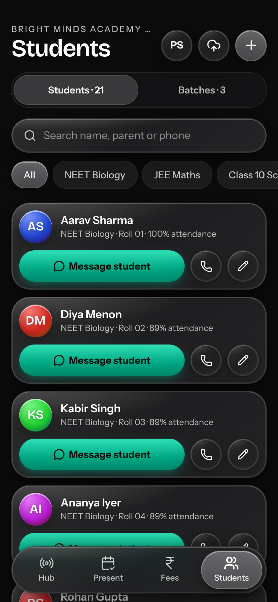
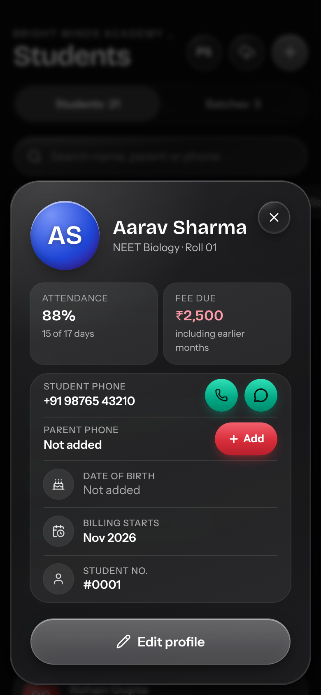
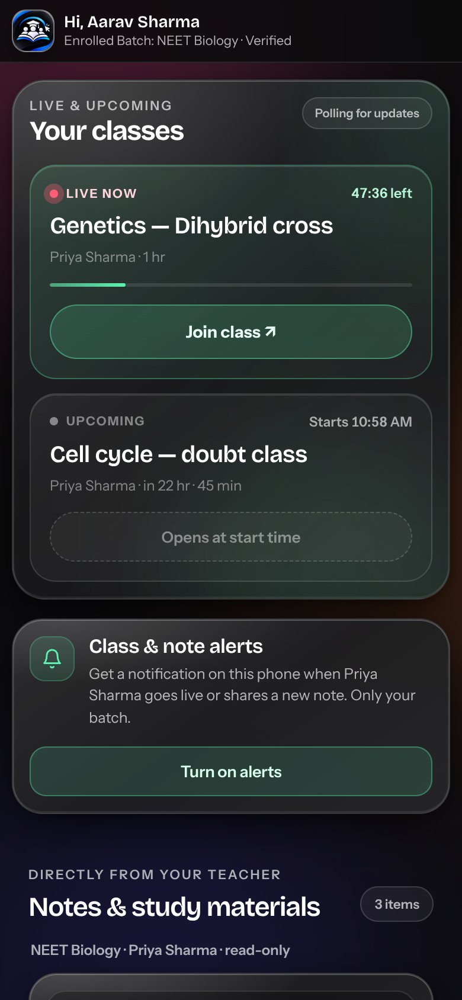
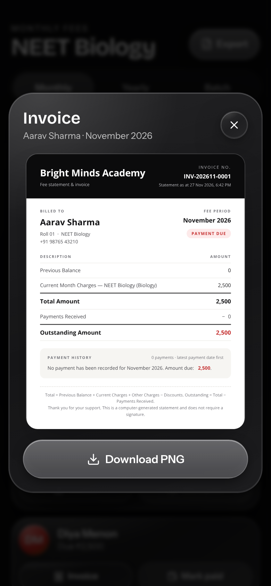
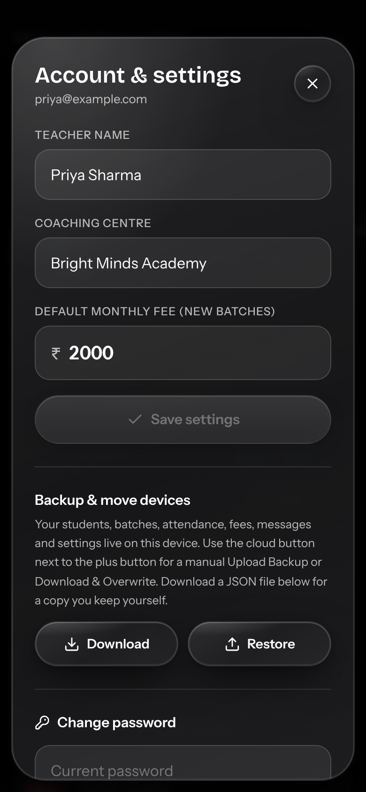

# Coaching Sathi

An offline-first, installable PWA for small coaching centres in India: swipe to mark attendance, track
monthly fees, take payments, send WhatsApp messages to parents, export reports to Excel, and publish a
read-only **Student Hub** for the class.

[](https://github.com/VinaySoni-IN/Coaching-Sathi/actions/workflows/ci.yml)
[](https://github.com/VinaySoni-IN/Coaching-Sathi/actions/workflows/pages.yml)
[](LICENSE)
[](public/manifest.webmanifest)

**[Open the app](https://vinaysoni-in.github.io/Coaching-Sathi/)** · **[Student Portal](https://vinaysoni-in.github.io/Coaching-Sathi/student-hub/)**

It is built for a phone, not a dashboard. One teacher, one hand, 40 students, a 3G connection and a
laptop that is never opened. Everything a class needs works with the screen locked in a pocket: the data
lives on the device, and nothing uploads itself.

## Screenshots

Every shot is the real app at phone width (390 × 844 @2x), signed in with the app's own **sample
workspace** — 21 students across **NEET Biology**, **JEE Maths** and **Class 10 Science**.

|  |  |  |
| --- | --- | --- |
|  |  |  |
| **Swipe attendance** | **Day marked, ready to lock** | **Fees ledger** |
|  |  |  |
| **Students** | **Student profile** | **Hub links, one per student** |
|  |  |  |
| **Student Portal** | **Invoice** | **Account &amp; settings** |

### About the sample data

The shots use the app's own **sample workspace** — the *Start with sample students* checkbox on the
sign-up screen (21 students across three batches, three weeks of attendance, a month of fee receipts).
It is generated on the device and never leaves it unless you upload a backup. No demo roster exists in
Supabase, and **no demo login is published here** — creating an account takes a minute, and it is yours.

## Features

- **Swipe attendance** — swipe a student card left for **present**, right for **absent**
  (`src/components/SwipeDeck.tsx`). A calendar sheet opens any past day; a day can be locked once it's
  done so marks can't change by accident.
- **Students & batches** — add/edit students and batches, roll numbers, join dates, optional profile
  details (DOB, parent name and phone, profile photo resized in the browser before saving).
- **Fees ledger** — monthly fee per batch with fee history, per-student discounts and extra charges,
  partial and back-dated payments, receipts with sequential numbers, FIFO or month-first allocation,
  reversals that never delete history, and derived outstanding/advance balances (`src/lib/ledger.ts`,
  `src/lib/accounts.ts`, `src/lib/payments.ts`).
- **Reminders & messages** — templated WhatsApp messages for presence, absence and fee reminders,
  opened through `wa.me` links (`src/lib/wa.ts`).
- **Reports** — printable invoices/statements and `.xlsx` export via SheetJS (`src/lib/report.ts`).
- **Manual cloud Backup & Restore** — the cloud button beside `+` opens exactly two actions:
  *Upload Backup (Sync to Cloud)* and *Download &amp; Overwrite (Restore Data)*. Each backup is one
  complete, replaceable snapshot tied to the signed-in teacher, guarded by row-level security
  (`src/lib/cloudBackup.ts`, `src/components/BackupMenu.tsx`, `supabase/migrations/`).
- **File backup & restore** — JSON export/import of a teacher's whole dataset (`src/lib/backup.ts`).
- **Teacher accounts** — Supabase Auth handles email + password, session restore, password reset and
  the profile name. Each teacher's workspace lives under their own `coachdesk:data:<userId>` key; no
  background sync or merge runs (`src/lib/auth.ts`). Deleting the account requires typing `DELETE` and
  erases the profile, workspace, legacy rows and cloud backup from the device and Supabase.
- **Student Hub Manager** — the first (far-left) Teacher App icon controls the live class topic/URL,
  **meeting duration (30/45/60 quick buttons + custom minutes → `duration_minutes` / `expires_at`)**,
  switches the class ON/OFF, and organises files/PDFs, links and text notes into **batch-tagged
  folders**. It also copies the `./student-hub/` link, and issues **one single-use link per student**
  (`src/components/StudentHubManager.tsx`, `src/lib/studentHub.ts`).
- **Student Portal** — `student-hub/index.html` is a standalone, read-only, single-page portal: one-time
  name + batch onboarding saved in `localStorage`, a teacher picker and top-bar **Switch Teacher**
  control, a live card with a duration badge and countdown that hides the class at `expires_at`, notes
  grouped by folder for exactly the selected batch and teacher, and optional push alerts. Relative
  assets, anonymous SELECT-only client.
- **Installable PWA** — standalone display, transparent-corner app icons at every size, maskable icon,
  Apple touch icons, an offline-first service worker and install screenshots (`public/`, `sw.js`).
  The install surfaces are wired, not decorative: **shortcuts** open Attendance / Fees / Students / Hub,
  a `web+coachingsathi:` link does the same, opening a `.json` backup with the app goes straight to the
  restore confirmation, and the Android **share sheet** fills "Add student" from a shared contact.
  Every manifest member, including the four we deliberately leave out, is explained in
  [`docs/pwa.md`](docs/pwa.md) and pinned by `tests/pwa.test.ts`.

## Getting started

```bash
npm ci             # exact, reproducible install
npm run dev        # http://localhost:5173
```

| Script | What it does |
| --- | --- |
| `npm run dev` | Vite dev server (binds to all interfaces, accepts proxied preview hosts) |
| `npm run build` | Type-check (`tsc -b`) and build to `dist/` |
| `npm run preview` | Serve the production build |
| `npm test` | Vitest suite (happy-dom) |
| `npm run lint` | ESLint (0 errors; React Compiler advisories surface as warnings) |

No keys are required to run it. Without a Supabase project, everything works except accounts, cloud
backup and the Student Hub — those say so plainly instead of failing silently.

## Self-hosting

The app is static: any host that serves `dist/` works, including a sub-path. Two are wired up already:

- **GitHub Pages** — `.github/workflows/pages.yml` builds and deploys on every push to `main`.
- **Vercel** — `vercel.json` serves the same build; the button at the top clones it in one step.

Cloud features need a Supabase project:

1. Create a project, then run the SQL in `supabase/migrations/` in order (they create the tables,
   the `notes` view, the storage buckets and every row-level-security policy).
2. Put the **public** project URL and anon key in `student-hub/config.json` — both apps read that one
   file — or set `VITE_SUPABASE_URL` / `VITE_SUPABASE_ANON_KEY` at build time to override it.
3. Nothing else. Writes are authorised by RLS, never by the anon key, so publishing the key is safe and
   is the intended design.

## Privacy and security

- The workspace is **local-first**: attendance, fees and student details never leave the phone unless the
  teacher taps *Upload Backup* or downloads a JSON file.
- Student access is decided by **row-level security** in Supabase, not by a hidden button. The Student
  Portal reads only the batch its own link belongs to.
- Magic links are single-use, revocable, and removing a student revokes their links and device access.
- `docs/SECURITY_AUDIT.md` holds the threat model, the checklist the project is verified against, and
  the history of findings — including the incident where a demo login was published in this README.
  A test (`tests/security.test.ts`) now fails the build if a login reappears in the docs.
- Found something? Please report it privately — see [`SECURITY.md`](SECURITY.md). Never open a public
  issue containing a login, a magic link or a student's data.

## Project layout

```
src/
  App.tsx            shell, routing between pages, all the confirm/toast orchestration
  components/        screens, bottom sheets, BackupMenu and StudentHubManager
  lib/
    store.ts         persisted state + useAttendance hook
    studentHub.ts    meeting duration, batch folders and notes helpers for the Teacher App
    sanitize.ts      trim/control-strip/escaping for all Teacher App text inputs
    ledger.ts        fee steps, marks, derivation/sanitising of saved state
    accounts.ts      statements, outstanding, ageing
    payments.ts      receipts, allocation, discounts, charges, reversals
    report.ts        invoice/report rendering + xlsx export
    wa.ts            WhatsApp templates and link building
    auth.ts          Supabase teacher accounts and sessions
    cloud.ts         lazy Supabase client + friendly error messages
    cloudBackup.ts   explicit snapshot upload / fetch / local overwrite
    launch.ts        home-screen shortcuts, protocol links, opened backups, share sheet
    money.ts, phone.ts, email.ts, backup.ts, photo.ts, …
public/              manifest, app icons + favicon, install screenshots, service worker
student-hub/         standalone Student Portal: index.html, styles.css, portal.js, sanitize.js,
                     config.json, vendor/supabase.js
supabase/            SQL migrations: tables, the notes view, storage policies, RLS
tests/               Vitest suites (unit + component + E2E-style flows)
docs/                screenshots, security audit, manifest audit notes (pwa.md), Student Hub notes
```

## Notes

- Money is handled in **paise** (integers) everywhere; `src/lib/money.ts` formats to ₹.
- Storage keys are prefixed `coachdesk:` — accounts, session, and one data blob per teacher.
- `xlsx` is installed from the npm registry (`^0.18.5`) rather than the SheetJS CDN tarball so
  `npm ci` works in environments that can't reach `cdn.sheetjs.com`.
- All asset URLs are relative (`base: './'`) and the service worker caches with relative paths, so the
  build works from a domain root *or* a sub-path without changes. The Student Portal uses only relative
  paths too, and the service worker deliberately leaves `/student-hub/` to the network.
- CI (`.github/workflows/ci.yml`) runs lint + tests + build on every push to `main` and every PR;
  `pages.yml` deploys the build.
- Dependabot proposes dependency updates weekly and GitHub Actions updates monthly.

## Contributing

Issues and pull requests are welcome — start with [`CONTRIBUTING.md`](CONTRIBUTING.md). The short
version: `npm test` and `npm run lint` green, a test that protects the behaviour, phone-width
screenshots for UI changes, and no credentials or real student data in any commit.

Participation is covered by the [`CODE_OF_CONDUCT.md`](CODE_OF_CONDUCT.md).

## License

[MIT](LICENSE) © 2026 Vinay Soni. Use it, fork it, run your own coaching centre on it.
