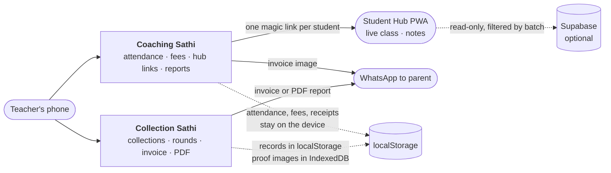

# The Sathi ecosystem

Two small, local-first apps for people who run a class or a collection on one phone. They are separate
projects with separate licenses and separate data — they simply come from the same idea: **the phone in
your pocket is the database, and nothing uploads itself.**

## Where each app stops

| | **Coaching Sathi** | **Collection Sathi** |
| --- | --- | --- |
| Built for | A coaching class: one teacher, batches of students, monthly fees | A group fund: chanda, festival or class collections, many payers, several rounds |
| Records | Attendance, per-student monthly fees, part payments, adjustments, charges | Cash + UPI entries per person, verification state, proof images, multiple rounds |
| Money view | Who paid this month, who is due, receipts and invoices per student | Round totals, Cash/UPI split, average, max, all-time summary |
| Leaves the phone | Only what the teacher publishes: the read-only Student Hub (optional Supabase), plus WhatsApp messages the teacher sends | Nothing. Proof images and records stay in the browser |
| Paper out | Excel export, per-student invoice | Printable invoice, stamped PDF report, CSV |
| Install | PWA (`vinaysoni-in.github.io/Coaching-Sathi/`) | PWA + Android APK (`releases/latest`) |

If the question is *"was Aarav in class, and has he paid November?"* use **Coaching Sathi**.
If the question is *"how much has this round collected, and who is still unverified?"* use **Collection Sathi**.

## How they fit together

Read it as three lanes:

1. **The teacher's phone** is the only place data is edited. Both apps open offline and write to that device.
2. **The class lane** publishes outward on purpose: a per-student magic link opens the Student Hub, and an
   invoice or reminder is turned into a WhatsApp message the teacher chooses to send.
3. **The collection lane** never publishes anything. It prints — invoice, PDF report with proofs — and the
   teacher shares that paper or image by hand.

## Shared rules (and where they differ)

- **Local-first.** Neither app needs an account to work. Coaching Sathi's teacher account exists only to
  publish the Student Hub and to keep a manual cloud backup; Collection Sathi has no account at all.
- **No silent uploads.** Coaching Sathi uploads only when the teacher taps *Backup* or publishes a note.
  Collection Sathi never opens a connection for data.
- **Backups are a file you can hold.** Both export a JSON document (Coaching Sathi also backs up to the
  teacher's own Supabase row on request; Collection Sathi never does).
- **Installable, both of them.** Both are PWAs with their own icons and install screenshots; Collection
  Sathi additionally ships an Android APK.

## Links

| App | Source | Live | Notes |
| --- | --- | --- | --- |
| **Coaching Sathi** | [VinaySoni-IN/Coaching-Sathi](https://github.com/VinaySoni-IN/Coaching-Sathi) | [Teacher app](https://vinaysoni-in.github.io/Coaching-Sathi/) · [Student Hub](https://vinaysoni-in.github.io/Coaching-Sathi/student-hub/) | React + TypeScript + Supabase, MIT |
| **Collection Sathi** | [VinaySoni-IN/Collection-Sathi](https://github.com/VinaySoni-IN/Collection-Sathi) | [Web app](https://vinaysoni-in.github.io/Collection-Sathi/) · [APK](https://github.com/VinaySoni-IN/Collection-Sathi/releases/latest) | Single-file HTML/CSS/JS, no build step, MIT |

Both are MIT licensed and maintained by [Vinay Soni](https://github.com/VinaySoni-IN).
